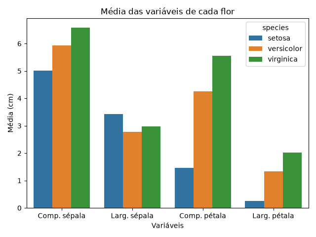
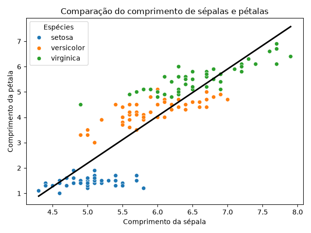
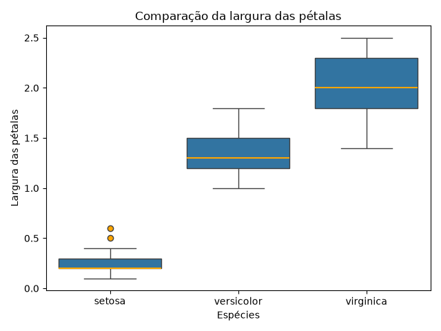

# Primeira questão:

O primeiro gráfico nos mostra a diferença entre o tamanho médio de cada variável entre as espécies. É visível que a virginica tem a tendência de ser a maior em quase todos os aspectos. O único que não é, é o comprimento da sépala, que é liderado pelas setosas, que curiosamente tem a tendência de serem as menores.

### Gráfico:

# Segunda questão:

O segundo gráfico nos mostra que no geral, existe uma tendência a crescer o comprimento da pétala junto com o comprimento da sépala. As setosas, no entanto, não aparentam seguir essa tendência de crescimento. 

### Gráfico:

# Terceira questão:

Gráfico de caixas, com a mediana e outliers destacados em laranja. Mostra o quanto as setosas se destoam das outras. É possível ver dois outliers nas setosas, e que ela tem uma mediana bem baixa comparada com as medianas dos outros para si mesmos. 

### Gráfico:

