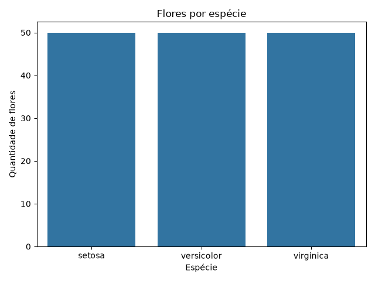
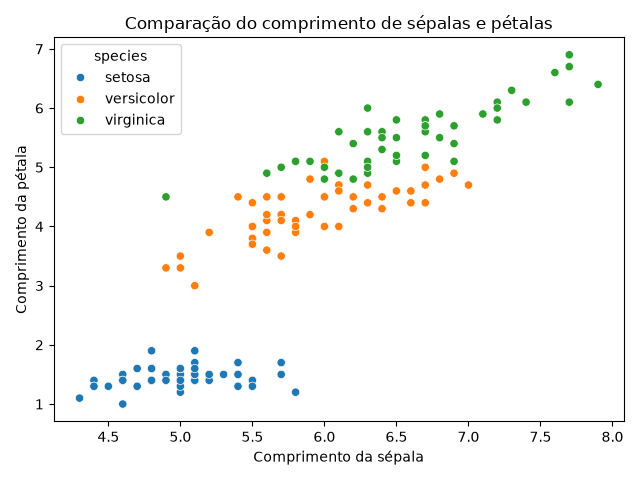

## Análise exploratória com base Iris:
Trata-se de uma análise da base iris com pandas, matplotlib e seaborn. 

## Para rodar: 
  
    pip install scikit-learn matplotlib seaborn
    python atividade_dados1.py

Ao rodar, todos os 5 gráficos abrirão em sequência, feche o atual para ver o próximo.

## O que eu fiz:
Explorei o uso de diversos tipos de gráficos diferentes. Usando o gráfico de barras pude ver a quantidade total, e os tipos de espécies que estava na base. Além disso, fiz um diagrama de caixas(boxplot) para comparação entre comprimento e largura entre as diferentes espécies,  E por fim, utilizei de um gráfico de dispersão(scatterplot) para verificar se havia algum padrão, e então utilizei a função corr() para calcular esse padrão. 

## O que descobri:
inicialmente pensei que a largura separava melhor, porém após comparar melhor, notei que ambas as variáveis separavam bem as espécies. Com esse diagrama também pude ver de forma visual que havia uma espécie muito menor que as outras.
Com uso da função corr() achei os seguintes valores de correlação entre comprimento da sépala e pétala: 0,27 para Setosas, 0,75 para Versicolores e 0,86 para Virginicas. Com esses dados, percebi que duas das espécies de flor tinham tendências a crescer o comprimento da pétala e da sépala em conjunto, enquanto a outra espécie não tinha.

## Gráficos:

